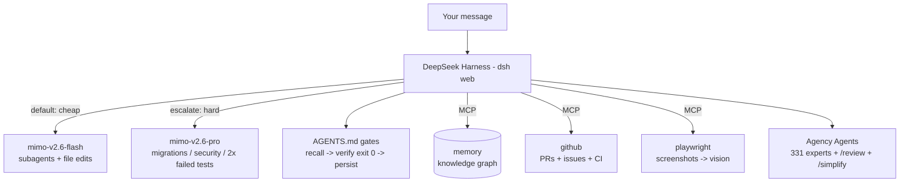

# mimo-agent-pipeline

> An end-to-end **autonomous engineering pipeline** for [DeepSeek Harness](https://github.com/deepseek-ai/deepseek-harness) — dual-model **Xiaomi MiMo** routing, persistent MCP memory, independent code review, and deterministic verification gates.

 

## What this is

A **configuration + orchestration layer** (not a new framework) that turns a stock DSH install into a tiered autonomous pipeline:

- **Cheap-by-default model routing** — subagents and daily edits run on `mimo-v2.6-flash`; complex work escalates to `mimo-v2.6-pro` with high reasoning.
- **Persistent memory** — a knowledge-graph MCP server that survives across sessions.
- **Independent verification** — `/review` grades your diff with a *separate* agent; `AGENTS.md` forbids "done" until tests + linter + typechecker exit `0`.
- **331 summonable experts** via the Agency Agents plugin.

## Architecture



## What's inside

| File | Purpose |
|---|---|
| `AGENTS.md` | Verification gates: recall first, verify before done (exit code 0), persist learnings, no `.env` access |
| `config/cordis.patch.yml.example` | **The pipeline config** — MiMo routes + reasoning levels + 3 MCP servers (sanitized template) |
| `config/settings.yaml.example` | Same routing expressed in DSH's `settings.yaml` style |
| `install.sh` | Installs the 3 plugins + pinned memory server into your DSH profile |
| `verify.sh` | Exit-code-0 gate: proves all 7 components mounted via `dsh --dump-config` |

## Quick start

**Prerequisites:** [DeepSeek Harness](https://github.com/deepseek-ai/deepseek-harness) installed (`dsh` on PATH), Node 22+, `MIMO_API_KEY` exported for the direct route.

```bash
git clone https://github.com/Abdelrahman-0-20/mimo-agent-pipeline.git
cd mimo-agent-pipeline
./install.sh                              # plugins + memory server
# merge config/cordis.patch.yml.example into $DSH_HOME/profiles/<profile>/cordis.patch.yml
./verify.sh                               # must print 7x PASS and exit 0
```

Then restart `dsh web` and hard-refresh the browser.

## How the pipeline works

### 1. Tiered model routing

| Situation | Model | Reasoning |
|---|---|---|
| Subagents, file edits, routine work | `mimo-v2.6-flash` | `low` |
| Database migrations | `mimo-v2.6-pro` | `high` |
| Security boundaries | `mimo-v2.6-pro` | `high` |
| 2 failed test-fix iterations | switch to `mimo-v2.6-pro` | `high` |

Default stays on Flash for cost; escalate with `/model` in the composer.

### 2. Verification gates (`AGENTS.md`)

1. **Recall first** — search memory before touching architecture.
2. **Verify before done** — test suite + linter + typechecker must exit `0`.
3. **Persist learnings** — non-obvious fixes become memory entities.
4. Guardrails — never read/commit `.env` or keys; keep diffs minimal.

### 3. MCP servers

| Server | Tools | Why |
|---|---|---|
| `memory` | `mcp__memory__search_nodes`, `mcp__memory__create_entities` | Cross-session knowledge graph (`~/.dsh/memory.jsonl`) |
| `github` | `mcp__github__*` | PRs, issues, CI failure logs (needs `GITHUB_TOKEN`) |
| `playwright` | `mcp__playwright__*` | Screenshots fed into MiMo's native vision input |

## Verification

```$ ./verify.sh
PASS  Agency Agents plugin (331 experts)
PASS  /review independent code review
PASS  /simplify git-scoped cleanup
PASS  MiMo direct route (Pro/Flash)
PASS  MCP memory server
PASS  MCP github server
PASS  MCP playwright server
7 passed, 0 failed
```

## Roadmap

| Version | Ships | Status |
|---|---|---|
| **v0.1** | Config kit + install/verify scripts + gates | ✅ current |
| **v0.2** | CI running `verify.sh` + demo GIF (cross-session memory) | ⬜ |
| **v0.3** | **Auto-escalation plugin** — Flash→Pro after 2 failed test rounds (original code) | ⬜ |
| **v0.4** | Flash-vs-Pro cost/quality benchmark on identical tasks | ⬜ |
| **v1.0** | Case study: pipeline builds a full MLOps project end-to-end | ⬜ |

## Security

- This repo contains **no secrets** — only environment-variable *names* (`MIMO_API_KEY`, `GITHUB_TOKEN`).
- `.gitignore` blocks `.env`, `*.jsonl`, and memory files.
- Never commit your `.dsh/.credentials.yaml`.

## Credits

- [DeepSeek Harness](https://github.com/deepseek-ai/deepseek-harness) — the agent harness
- Xiaomi MiMo — `mimo-v2.6-pro` / `mimo-v2.6-flash`
- [MichengAI/dsh-agency-agents](https://github.com/MichengAI/dsh-agency-agents), `dsh-code-review`, `dsh-simplify` plugins
- MCP reference servers (memory, github, playwright)

[](https://github.com/deepseek-ai/deepseek-harness)
