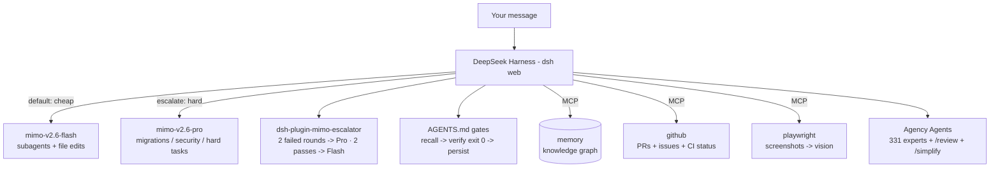

# mimo-agent-pipeline

> An end-to-end **autonomous engineering pipeline** for [DeepSeek Harness](https://github.com/deepseek-ai/deepseek-harness): tiered **Xiaomi MiMo** routing with a self-written auto-escalation plugin, persistent MCP memory, independent code review, and deterministic verification gates.

  

## What you get

- **Cheap-by-default model routing** — subagents and daily edits run on `mimo-v2.6-flash`; hard work runs on `mimo-v2.6-pro` with high reasoning. Escalate manually with `/model`, or let **`dsh-plugin-mimo-escalator`** (this repo's original code) do it automatically: 2 consecutive failed verification rounds → Pro, 2 consecutive passes → back to Flash.
- **Persistent memory** — a knowledge-graph MCP server that survives across sessions.
- **Independent verification** — `/review` grades your diff with a *separate* agent; `AGENTS.md` forbids "done" until tests + linter + typechecker exit `0`.
- **331 summonable experts** via the Agency Agents plugin.
- **Measured, not assumed** — a real Flash-vs-Pro benchmark (raw data committed) plus CI that reproduces the entire pipeline on a clean machine.

## Architecture



## Repository layout

| Path | Purpose |
|---|---|
| [`AGENTS.md`](AGENTS.md) | Verification gates: recall first, verify before done (exit code 0), persist learnings, no `.env` access |
| [`config/cordis.patch.yml.example`](config/cordis.patch.yml.example) | Pipeline config template — MiMo routes + reasoning levels + 3 MCP servers (sanitized) |
| [`config/settings.yaml.example`](config/settings.yaml.example) | Same routing in DSH's `settings.yaml` style |
| [`install.sh`](install.sh) | Installs the 3 MichengAI plugins + the local escalator bundle + pinned memory server |
| [`verify.sh`](verify.sh) | Exit-code-0 gate: proves all 8 components mounted via `dsh --dump-config` |
| [`dsh-plugin-mimo-escalator/`](dsh-plugin-mimo-escalator/) | **Original plugin (v0.3/v0.4)** — auto Flash↔Pro escalation with hysteresis, per-workspace persistence, metrics, CI-status detection · `npm test` |
| [`benchmark/`](benchmark/) | **v0.4 benchmark** — identical tasks via `dsh headless --json`, real token usage in [`benchmark/results.json`](benchmark/results.json) |

## Quick start

**Prerequisites:** [DeepSeek Harness](https://github.com/deepseek-ai/deepseek-harness) installed (`dsh` on PATH), Node 22+, `MIMO_API_KEY` exported for the direct route.

```bash
git clone https://github.com/Abdelrahman-0-20/mimo-agent-pipeline.git
cd mimo-agent-pipeline
./install.sh                              # plugins + escalator + memory server
# merge config/cordis.patch.yml.example into $DSH_HOME/profiles/<profile>/cordis.patch.yml
./verify.sh                               # must print 8x PASS and exit 0
```

Then restart `dsh web` and hard-refresh the browser.

## How the pipeline works

### 1. Tiered model routing

| Situation | Model | Reasoning |
|---|---|---|
| Subagents, file edits, routine work | `mimo-v2.6-flash` | `low` |
| Database migrations | `mimo-v2.6-pro` | `high` |
| Security boundaries | `mimo-v2.6-pro` | `high` |
| 2 failed verification rounds | auto-switch to `mimo-v2.6-pro` | `high` |

Default stays on Flash for cost. The escalator plugin watches verification rounds — local `bash` commands and, with `ciDetection: true`, GitHub CI status queries — and flips the session tier with full hysteresis (promotion after 2 failures, demotion after 2 passes). Every transition is persisted per workspace to the gitignored `mimo-escalator-state.json` (72 h TTL) with counters and history.

### 2. Verification gates (`AGENTS.md`)

1. **Recall first** — search memory before touching architecture.
2. **Verify before done** — test suite + linter + typechecker must exit `0`.
3. **Persist learnings** — non-obvious fixes become memory entities.
4. **Guardrails** — never read/commit `.env` or keys; keep diffs minimal.

### 3. MCP servers

| Server | Tools | Why |
|---|---|---|
| `memory` | `mcp__memory__search_nodes`, `mcp__memory__create_entities` | Cross-session knowledge graph (`~/.dsh/memory.jsonl`) |
| `github` | `mcp__github__*` | PRs, issues, CI failure logs (needs `GITHUB_TOKEN`) |
| `playwright` | `mcp__playwright__*` | Screenshots fed into MiMo's native vision input |

## The escalator plugin

Shipped in v0.3, hardened in v0.4. Pure-JS, zero runtime dependencies, correct DSH bundle manifest (`manifestVersion: 1`, top-level-array patch). Configuration lives in its [`cordis.patch.yml`](dsh-plugin-mimo-escalator/cordis.patch.yml):

| Field | Default | Meaning |
|---|---|---|
| `threshold` | `2` | consecutive failed rounds before Flash → Pro |
| `demoteThreshold` | `2` | consecutive passes before Pro → Flash |
| `baseModel` / `model` | `mimo-v2.6-flash` / `mimo-v2.6-pro` | tier endpoints |
| `reasoningEffort` | `high` | effort used while escalated |
| `statePath` | `mimo-escalator-state.json` | per-workspace state file (gitignored) |
| `stateTtlHours` | `72` | prune idle entries (`0` = keep forever) |
| `ciDetection` | `true` | count `mcp__github__get_pull_request_status` as a verification round |

**Evidence:** `npm test` → **29/29 pass, exit 0** (`node --test`, zero dependencies). Spec, inspect-first checklist, and review notes live in **[issue #1](https://github.com/Abdelrahman-0-20/mimo-agent-pipeline/issues/1)**.

## Benchmark — Flash vs Pro (v0.4)

Real usage captured **2026-11-17** at commit `0e59f04`: every row is a fresh `dsh headless --json` run over [`benchmark/model-overlay.yml`](benchmark/model-overlay.yml) — six identical tasks per model, harness-default sampling, the model swapped via `$BENCH_MODEL` so it is the *only* variable. Raw data with per-run answers: [`benchmark/results.json`](benchmark/results.json).

| Model | Quality | Output tok | Uncached in | Cache read | Avg wall |
|---|---|---|---|---|---|
| `mimo-v2.6-flash` | **6/6** | 237 | 36,615 | 6,144 | 5.1s |
| `mimo-v2.6-pro` | **6/6** | 795 | 9,569 | 40,832 | 5.7s |

**Reading the numbers (labeled):**

- **Quality did not discriminate** — both models solved all six tasks (three cognitive-reflection puzzles, an exact-string instruction, arithmetic, and a code task verified by *executing* the generated function against test cases). This suite is a baseline that proves the harness, not a ceiling; harder tasks are future benchmark iterations.
- **Output tokens are the honest axis**: Pro spent **3.4×** Flash's output (795 vs 237) — it reasons more per task.
- **Input/cache figures are order-dependent** — runs executed sequentially, and the headless persona embeds the model name, so each model has its own prompt prefix and server-side cache warmth. Do not read the uncached-input gap as a model property.
- Latency was comparable (≈5 s/task for both).

Reproduce (requires the stored MiMo credential in the DSH credentials service — never a key in this repo):

```bash
DSH_CLI=dsh node benchmark/run.mjs                # both models × all tasks
BENCH_TASKS=crt-lily-pad node benchmark/run.mjs   # a single task
BENCH_MODELS=mimo-v2.6-pro node benchmark/run.mjs # a single model
```

## Verification

```$ ./verify.sh
PASS  Agency Agents plugin (331 experts)
PASS  /review independent code review
PASS  /simplify git-scoped cleanup
PASS  MiMo direct route (Pro/Flash + reasoning levels)
PASS  MCP memory server
PASS  MCP github server
PASS  MCP playwright server
PASS  MiMo auto-escalation plugin (Flash->Pro, 2 strikes)
8 passed, 0 failed
```

## Continuous integration

Every push runs three jobs — and the pipeline job is an honest test: it reproduces the setup on a **clean Ubuntu runner** (install DSH → `install.sh` → merge config → `verify.sh`) and fails the build unless every component mounts.

```text
lint · yaml · secret-scan ............... PASS   shell syntax, YAML structure, no keys committed
pipeline · fresh-machine reproducibility  PASS   DSH + 4 plugins + MCP config → verify.sh exit 0
plugin · escalator unit tests ........... PASS   node --test (zero-dependency bundle)
```

## Multi-agent relay (v0.5, planned)

- **Role-scoped connector packs** — planner (github + memory + context7, pinned Pro) · scouts (repo/DB/docs read-only, parallel Flash) · builder (write + shell, single-writer lock, 2-strike escalation) · verifier (playwright + E2E, single-browser lock). DSH isolates MCP tools per agent scope, so scoping also cuts per-request tool-schema tokens and KV-cache churn.
- **Verified connector packages (2026-11-17):** `@upstash/context7-mcp` ✅ `4.7.3` · `@modelcontextprotocol/server-postgres` ✅ `0.6.2` · `@modelcontextprotocol/server-sqlite` ❌ **does not exist — do not use**
- **Per-role escalator keys** — `<workspace>:<role>` (e.g. `repo:builder`) so a builder's 2-strike failure never escalates the planner.
- **Sequential relay** — Planner (Pro, read-only) → Builder (Flash, workspace-write lock) → Verifier (Flash, browser/dev-server lock); only read-only discovery runs in parallel.
- **Handoff contract** — planner emits file list + test plan; verifier reports defects, never patches; builder exits only on test/lint exit `0`.

## Roadmap

| Version | Ships | Status |
|---|---|---|
| **v0.1** | Config kit + install/verify scripts + gates | ✅ |
| **v0.2** | CI: fresh-machine reproducibility gate + secret scan + badge | ✅ |
| **v0.3** | **Auto-escalation plugin** — Flash→Pro after 2 failed rounds (original code) | ✅ |
| **v0.4** | Metrics + persistence/TTL + CI-status detection + real-usage benchmark | ✅ |
| **v0.5** | Multi-agent relay (Planner→Builder→Verifier): per-role keys, connector locks | ⬜ |
| **v1.0** | Case study: pipeline builds a full MLOps project end-to-end | ⬜ |

## Security

- This repo contains **no secrets** — only environment-variable *names* (`MIMO_API_KEY`, `GITHUB_TOKEN`).
- `.gitignore` blocks `.env`, `*.jsonl`, memory files, and `mimo-escalator-state.json`.
- Never commit your `.dsh/.credentials.yaml`.

## Credits

- [DeepSeek Harness](https://github.com/deepseek-ai/deepseek-harness) — the agent harness
- Xiaomi MiMo — `mimo-v2.6-pro` / `mimo-v2.6-flash`
- [MichengAI/dsh-agency-agents](https://github.com/MichengAI/dsh-agency-agents), `dsh-code-review`, `dsh-simplify` plugins
- MCP reference servers (memory, github, playwright)

[](https://github.com/deepseek-ai/deepseek-harness)
