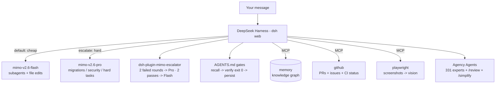

# mimo-agent-pipeline

> An end-to-end **autonomous engineering pipeline** for [DeepSeek Harness](https://github.com/deepseek-ai/deepseek-harness): tiered **Xiaomi MiMo** routing with a self-written auto-escalation plugin, persistent MCP memory, independent code review, and deterministic verification gates.

  

## What you get

- **Cheap-by-default model routing** — subagents and daily edits run on `mimo-v2.6-flash`; hard work runs on `mimo-v2.6-pro` with high reasoning. Escalate manually with `/model`, or let **`dsh-plugin-mimo-escalator`** (this repo's original code) do it automatically: 2 consecutive failed verification rounds → Pro, 2 consecutive passes → back to Flash.
- **Persistent memory** — a knowledge-graph MCP server that survives across sessions.
- **Independent verification** — `/review` grades your diff with a *separate* agent; `AGENTS.md` forbids "done" until tests + linter + typechecker exit `0`.
- **331 summonable experts** via the Agency Agents plugin.
- **Measured, not assumed** — a real Flash-vs-Pro benchmark (raw data committed) plus CI that reproduces the entire pipeline on a clean machine.

## Architecture




*Captured live from the Harness Web GUI: **①** persisting knowledge-graph learnings via `mcp__memory__create_entities`, **②** a `mimo_relay` run — planner → builder → verifier — from the pricing-repo case test. Two full case studies document the pipeline on real work: [review & fix on a mature repo](docs/case-study-pricing.md) and [building an MLOps project from zero](docs/case-study-greenfield.md).*

## Repository layout

| Path | Purpose |
|---|---|
| [`AGENTS.md`](AGENTS.md) | Verification gates: recall first, verify before done (exit code 0), persist learnings, no `.env` access |
| [`config/cordis.patch.yml.example`](config/cordis.patch.yml.example) | Pipeline config template — MiMo routes + reasoning levels + 4 MCP servers (sanitized) |
| [`config/settings.yaml.example`](config/settings.yaml.example) | Same routing in DSH's `settings.yaml` style |
| [`install.sh`](install.sh) | Installs the 3 MichengAI plugins + the local escalator, relay & think bundles + pinned memory server |
| [`verify.sh`](verify.sh) | Exit-code-0 gate: proves all 11 components mounted via `dsh --dump-config` |
| [`dsh-plugin-mimo-escalator/`](dsh-plugin-mimo-escalator/) | **Original plugin (v0.3–v0.6)** — auto Flash↔Pro escalation with hysteresis, per-role `<workspace>:<role>` state keys, persistence, metrics, CI-status detection, thinking-off-on-discovery effort policy, standalone stdio MCP server (`mcp-server.mjs`) · `npm test` |
| [`dsh-plugin-mimo-relay/`](dsh-plugin-mimo-relay/) | **Original plugin (v0.5/v0.6)** — `mimo_relay` tool: Planner→Builder→Verifier over the `spawn` backend with role presets, connector locks, schema-checked handoff, per-role tool scoping (builder 85 → 9 schemas) · `npm test` |
| [`dsh-plugin-mimo-think/`](dsh-plugin-mimo-think/) | **Original plugin (v0.1)** — reasoning enhancer: prompt-scoring effort boost (hysteresis + TTL, re-asserts on work), `mimo_think` deep-reasoning child (Pro @ high, read-only, structured verdict), `mthink_status` metrics · `npm test` |
| [`benchmark/`](benchmark/) | **v0.4 benchmark** — identical tasks via `dsh headless --json`, real token usage in [`benchmark/results.json`](benchmark/results.json) |

## Quick start

**Prerequisites:** [DeepSeek Harness](https://github.com/deepseek-ai/deepseek-harness) installed (`dsh` on PATH), Node 22+, `MIMO_API_KEY` exported for the direct route.

```bash
git clone https://github.com/Abdelrahman-0-20/mimo-agent-pipeline.git
cd mimo-agent-pipeline
./install.sh                              # plugins + escalator + relay + memory server
# merge config/cordis.patch.yml.example into $DSH_HOME/profiles/<profile>/cordis.patch.yml
./verify.sh                               # must print 11x PASS and exit 0
```

Then restart `dsh web` and hard-refresh the browser.

> **`dsh` name collisions on Linux:** two known traps — a leftover *broken* symlink at `/usr/local/bin/dsh` (an old Harness install) and an unrelated Debian package that ships its own `dsh` (**Dancer's shell**, seen here on 2026-11-18). `install.sh` and `verify.sh` therefore prefer `$DSH_CLI` over PATH and signature-check any PATH `dsh` against the Harness version output; if a gate fails with `FAIL: 'dsh' on PATH is Distributed Shell…`, run `export DSH_CLI=/path/to/dsh` (the source checkout's `apps/cli/lib/bin.js` works).

## How the pipeline works

### 1. Tiered model routing

| Situation | Model | Reasoning |
|---|---|---|
| Subagents, file edits, routine work | `mimo-v2.6-flash` | `low` |
| Database migrations | `mimo-v2.6-pro` | `high` |
| Security boundaries | `mimo-v2.6-pro` | `high` |
| 2 failed verification rounds | auto-switch to `mimo-v2.6-pro` | `high` |

Default stays on Flash for cost. The escalator plugin watches verification rounds — local `bash` commands and, with `ciDetection: true`, GitHub CI status queries — and flips the session tier with full hysteresis (promotion after 2 failures, demotion after 2 passes). Every transition is persisted per workspace to the gitignored `mimo-escalator-state.json` (72 h TTL) with counters and history — inspect it any time with the read-only `mescal_status` tool, which also reports why the most recent tool result was not counted.

### 2. Verification gates (`AGENTS.md`)

1. **Recall first** — search memory before touching architecture.
2. **Verify before done** — test suite + linter + typechecker must exit `0`.
3. **Persist learnings** — non-obvious fixes become memory entities.
4. **Guardrails** — never read/commit `.env` or keys; keep diffs minimal.

### 3. MCP servers

| Server | Tools | Why |
|---|---|---|
| `memory` | `mcp__memory__search_nodes`, `mcp__memory__create_entities` | Cross-session knowledge graph (`~/.dsh/memory.jsonl`) |
| `github` | `mcp__github__*` | PRs, issues, CI failure logs (needs `GITHUB_TOKEN`) |
| `playwright` | `mcp__playwright__*` | Screenshots fed into MiMo's native vision input |
| `context7` | `mcp__context7__*` | **v0.6** live API docs (keyless) — read today's APIs instead of recalling stale ones |

## The escalator plugin

Shipped in v0.3, hardened in v0.4. Pure-JS, zero runtime dependencies, correct DSH bundle manifest (`manifestVersion: 1`, top-level-array patch). Configuration lives in its [`cordis.patch.yml`](dsh-plugin-mimo-escalator/cordis.patch.yml):

| Field | Default | Meaning |
|---|---|---|
| `threshold` | `2` | consecutive failed rounds before Flash → Pro |
| `demoteThreshold` | `2` | consecutive passes before Pro → Flash |
| `baseModel` / `model` | `mimo-v2.6-flash` / `mimo-v2.6-pro` | tier endpoints |
| `reasoningEffort` | `high` | effort used while escalated |
| `statePath` | `mimo-escalator-state.json` | per-workspace state file (gitignored) |
| `stateTtlHours` | `72` | prune idle entries (`0` = keep forever) |
| `ciDetection` | `true` | count `mcp__github__get_pull_request_status` as a verification round |
| `discoveryEffortOff` | `true` | **v0.6** thinking-off-on-discovery: effort → `off` during discovery streaks |
| `discoverySteps` | `3` | consecutive read-only results before the effort goes off |
| `minToggleGapMs` | `15000` | debounce between OFF flips (work always restores immediately) |

**Evidence:** `npm test` → **29/29 pass, exit 0** (`node --test`, zero dependencies). Spec, inspect-first checklist, and review notes live in **[issue #1](https://github.com/Abdelrahman-0-20/mimo-agent-pipeline/issues/1)**.

## Benchmark — Flash vs Pro (v0.4)

Real usage captured **2026-11-17** at commit `0e59f04`: every row is a fresh `dsh headless --json` run over [`benchmark/model-overlay.yml`](benchmark/model-overlay.yml) — six identical tasks per model, harness-default sampling, the model swapped via `$BENCH_MODEL` so it is the *only* variable. Raw data with per-run answers: [`benchmark/results.json`](benchmark/results.json).

| Model | Quality | Output tok | Uncached in | Cache read | Avg wall |
|---|---|---|---|---|---|
| `mimo-v2.6-flash` | **6/6** | 237 | 36,615 | 6,144 | 5.1s |
| `mimo-v2.6-pro` | **6/6** | 795 | 9,569 | 40,832 | 5.7s |

**Reading the numbers (labeled):**

- **Quality did not discriminate** — both models solved all six tasks (three cognitive-reflection puzzles, an exact-string instruction, arithmetic, and a code task verified by *executing* the generated function against test cases). This suite is a baseline that proves the harness, not a ceiling; harder tasks are future benchmark iterations.
- **Output tokens are the honest axis**: Pro spent **3.4×** Flash's output (795 vs 237) — it reasons more per task.
- **Input/cache figures are order-dependent** — runs executed sequentially, and the headless persona embeds the model name, so each model has its own prompt prefix and server-side cache warmth. Do not read the uncached-input gap as a model property.
- Latency was comparable (≈5 s/task for both).

**v2 + v3 — harder, pre-declared tasks (2026-11-19):** four harder tasks (`results-v2.json`) and then three adversarial ones declared *before* running (`results-v3.json`) — every behavioral probe was validated first to reject naive implementations (merge-before-drop parsers, `toFixed` rounding, unsorted greedy topological sort).

| Model | v2 (4 tasks) | v3 (3 tasks) | v3 output tok | v3 avg wall |
|---|---|---|---|---|
| `mimo-v2.6-flash` | **4/4** | **3/3** | 1,227 | 13.6s |
| `mimo-v2.6-pro` | **4/4** | **2/3** (one API stall) | 2,850 | 73.0s |

- **Quality still does not discriminate at this difficulty.** Every answer the models actually produced was correct — including on the probes proven to reject naive solutions. The one Pro "failure" was infrastructure, not reasoning: two attempts of `code-bankers-round` hit the runner's 180 s cap with **0 tokens** (server-side stall), and a targeted re-run passed in 82 s.
- Both models answered the probability task as `1/17` — the correct *irreducible* form of 13/221 (the first v3 label was my check demanding the unreduced fraction; the models were right and the check was wrong).
- What differs is **cost and latency**: Pro spent 2.3× Flash's output tokens on v3 and averaged 73 s vs 14 s (its average includes the stalled run).
- **Open question for a future iteration:** one-shot codegen and puzzle logic do not separate these two models; long-horizon agentic work (exercised qualitatively by the two case studies) remains the candidate discriminating axis.

Reproduce (requires the stored MiMo credential in the DSH credentials service — never a key in this repo):

```bash
DSH_CLI=dsh node benchmark/run.mjs                # both models × all tasks
BENCH_TASKS=crt-lily-pad node benchmark/run.mjs   # a single task
BENCH_MODELS=mimo-v2.6-pro node benchmark/run.mjs # a single model
```

## Verification

```$ ./verify.sh
PASS  Agency Agents plugin (331 experts)
PASS  /review independent code review
PASS  /simplify git-scoped cleanup
PASS  MiMo direct route (Pro/Flash + reasoning levels)
PASS  MCP memory server
PASS  MCP github server
PASS  MCP playwright server
PASS  MiMo auto-escalation plugin (Flash->Pro, 2 strikes)
PASS  Multi-agent relay (Planner->Builder->Verifier)
PASS  context7 live-docs connector
PASS  MiMo thinking enhancer (prompt boost + mimo_think)
11 passed, 0 failed
```

## Continuous integration

Every push runs three jobs — and the pipeline job is an honest test: it reproduces the setup on a **clean Ubuntu runner** (install DSH → `install.sh` → merge config → `verify.sh`) and fails the build unless every component mounts.

```text
lint · yaml · secret-scan ............... PASS   shell syntax, YAML structure, no keys committed
pipeline · fresh-machine reproducibility  PASS   DSH + 5 bundles + MCP config → verify.sh exit 0
plugin · unit tests ..................... PASS   node --test (escalator + relay, zero-dependency)
```

## Multi-agent relay (v0.5, shipped)

One bundle — [`dsh-plugin-mimo-relay/`](dsh-plugin-mimo-relay/) — installs the **`mimo_relay`** tool plus four role presets; the escalator keys its state per `<workspace>:<role>`.

- **Role-scoped connector packs** — planner (github + memory + context7, pinned Pro) · scouts (repo/DB/docs read-only, parallel Flash) · builder (write + shell, single-writer lock, 2-strike escalation) · verifier (playwright + E2E, single-browser lock). DSH isolates MCP tools per agent scope, so scoping also cuts per-request tool-schema tokens and KV-cache churn.
- **Verified connector packages (2026-11-17):** `@upstash/context7-mcp` done `4.7.3` · `@modelcontextprotocol/server-postgres` done `0.6.2` · `@modelcontextprotocol/server-sqlite` no **does not exist — do not use**
- **Per-role escalator keys** — `<workspace>:<role>` (e.g. `repo:builder`) so a builder's 2-strike failure never escalates the planner. Escalation is role-level: every session of the role adopts it on its next counted round, and stale sessions return home after the role demotes. Store version bumped to v2 (v1 session-id keys load as empty).
- **Sequential relay** — `mimo_relay` drives Planner (Pro, read-only) → Builder (Flash) → Verifier (Flash) over the DSH `spawn` subagent backend: each phase runs on its role preset, holds its connector lock (`reader:` / `writer:` / `browser:<workspace>`) for the whole phase, and passes its handoff through the backend's `outputSchema`. Locks are exclusive FIFO mutexes in v0.5 — parallel readers and cross-relay snapshot isolation are deferred.
- **Handoff contract** — planner emits `{files, testPlan}`; the builder claims `status: "pass"` only when every testPlan command exited 0; the verifier reports `{defects, summary}` and never patches. Any contract violation aborts the relay at that phase with the reason.

**Evidence:** 19 relay + 31 escalator unit tests (`node --test`, exit 0); `verify.sh` **9/9** including check #9; and a **live end-to-end relay run**: planner's `{files, testPlan}` → builder `status: "pass"` (byte-exact artifact, full testPlan green — both suites, `bash -n`, `node --check`, secret scan) → verifier `defects: []` with an independent audit of the builder's work; every connector lock released.

**Deferred:** parallel scout fan-out, shared-reader locks, cross-relay snapshot isolation, file-based handoff artifacts.

## Cost & reach (v0.6, shipped)

Four levers, each verified live:

- **Thinking-off-on-discovery** — the escalator's effort policy classifies every tool result (reads/grep/docs = discovery, everything else = work), flips `reasoningEffort` to `off` after `discoverySteps` consecutive discovery results (debounced by `minToggleGapMs`; a single work result restores the saved effort immediately), and goes dormant while the tier escalator owns the selection. Every toggle records a `tokenMeter` sample (total tokens + baseline/cache-read when available) into the state file — **compare cache-read before/after an OFF flip before trusting the savings**. Live cycle proven: `effort {off: 1, on: 1}` with the model selection flipping `off` → adapter default.
- **Connector-pack token cuts** — at `agent/created`, relay-role children receive `tools.restrict({deny})`: a common noise list (experts, teams, subagents, scheduling, inspection, relay recursion) plus **only the host MCP servers the role does not preset-mount**, so a deny name can never collide with the role's own scoped connector. Live: builder **85 → 9 tool schemas (−89%)**, verifier → 32, planner → 43 (keeps github/memory/context7 by design).
- **context7 live-docs** — `@upstash/context7-mcp` `4.7.3` (keyless) added to the config template's MCP section; `verify.sh` check #10 proves it mounts (**10/10**).
- **Standalone stdio MCP server** — [`dsh-plugin-mimo-escalator/mcp-server.mjs`](dsh-plugin-mimo-escalator/mcp-server.mjs): zero-dependency JSON-RPC over stdio exposing the *same* state machine and store as `mescal_status` and `mescal_record_round`, so Cursor / Claude Code / VS Code hooks can drive escalation decisions:

  ```bash
  # works today (clone + local install):
  git clone https://github.com/Abdelrahman-0-20/mimo-agent-pipeline.git
  (cd mimo-agent-pipeline/dsh-plugin-mimo-escalator && npm install -g .)
  # once the npm publish lands: npm install -g dsh-plugin-mimo-escalator
  claude mcp add escalator -- mimo-escalator-mcp
  # or straight from this repo:
  claude mcp add escalator -- node /path/to/dsh-plugin-mimo-escalator/mcp-server.mjs
  # optional: MIMO_ESCALATOR_STATE=... MIMO_ESCALATOR_THRESHOLD=2 MIMO_ESCALATOR_DEMOTE_THRESHOLD=2
  ```

**Evidence:** 42 escalator + 20 relay tests (`node --test`, exit 0); `verify.sh` **10/10**; a live effort off/on cycle with persisted tokenMeter samples; a live relay re-run under scoping (plan → build `pass` → verifier `defects: []`, all locks released).

## Roadmap

| Version | Ships | Status |
|---|---|---|
| **v0.1** | Config kit + install/verify scripts + gates | done |
| **v0.2** | CI: fresh-machine reproducibility gate + secret scan + badge | done |
| **v0.3** | **Auto-escalation plugin** — Flash→Pro after 2 failed rounds (original code) | done |
| **v0.4** | Metrics + persistence/TTL + CI-status detection + real-usage benchmark | done |
| **v0.5** | Multi-agent relay (Planner→Builder→Verifier): per-role keys, connector locks | done |
| **v0.6** | **Cost & reach** — thinking-off-on-discovery · role-scoped connector packs · `context7` live-docs connector (check #10) · standalone stdio MCP server for other editors | done |
| **v0.7** | **Public launch** — final secret scan → repo goes public · demo GIF (memory recall + one relay run) · GitHub profile README + repo descriptions | pending |
| **v1.0** | Case study: the pipeline builds a full MLOps project end-to-end via the relay · harder benchmark tasks | ✅ case study shipped (`breast-cancer-mlops`, [greenfield write-up](docs/case-study-greenfield.md)) · benchmark v2 pending |

### The plan after v0.5

1. **v0.6 — Cost & reach.** Three cost levers + one reach lever:
   - *Thinking-off-on-discovery* — reasoning off during clean `grep`/`read` steps, back on for edits/tests/debugging; rides the escalator's already-proven `agent.model.select(…, reasoningEffort)` mechanism (debounced, and measured against cache-hit rate before trusting the savings).
   - *Role-scoped connector packs* — subagents carry only their tools, cutting per-request tool-schema tokens (DSH isolates MCP tools per agent scope).
   - *`context7` live-docs connector* (verified `4.7.3`, keyless) — the agent reads **today's** APIs instead of recalling stale ones → fewer wrong-code failures → fewer escalations → cheaper runs. Adds `verify.sh` check #10.
   - *Standalone stdio MCP server* — the same engine drives Cursor / Claude Code / VS Code (reach, not cost).
2. **v0.7 — Collect the reward.** Final secret scan → flip the repo **public**, add a demo GIF (cross-session memory recall + one relay run), and write the GitHub profile README + repo descriptions — profile polish *before* the case study, not after.
3. **v1.0 — The proof.** One real project (the `insurance-claim-mlops` rebuild: tests, CI, FastAPI, Docker) built end-to-end through the relay, plus harder benchmark tasks where Flash-vs-Pro quality finally discriminates.

## Security

- This repo contains **no secrets** — only environment-variable *names* (`MIMO_API_KEY`, `GITHUB_TOKEN`).
- `.gitignore` blocks `.env`, `*.jsonl`, memory files, and `mimo-escalator-state.json`.
- Never commit your `.dsh/.credentials.yaml`.

## Credits

- [DeepSeek Harness](https://github.com/deepseek-ai/deepseek-harness) — the agent harness
- Xiaomi MiMo — `mimo-v2.6-pro` / `mimo-v2.6-flash`
- [MichengAI/dsh-agency-agents](https://github.com/MichengAI/dsh-agency-agents), `dsh-code-review`, `dsh-simplify` plugins
- MCP reference servers (memory, github, playwright)

[](https://github.com/deepseek-ai/deepseek-harness)
