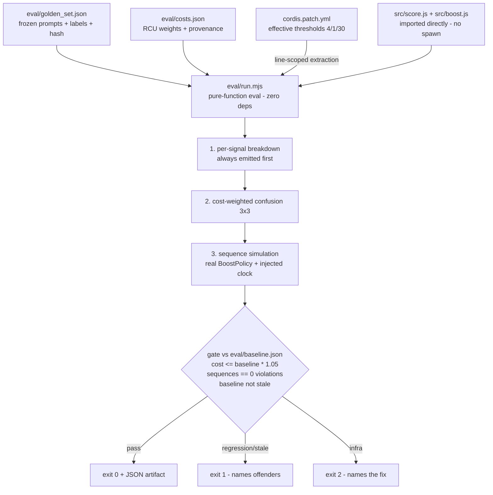

# 🏛️ mimo-think Eval Harness — Architectural Blueprint & Governance Plan

> **Status: PHASE 1 DESIGN — REVIEW ONLY. No code exists for this harness; nothing has been applied.**
> Phase 1 (this document) → user approval → Phase 2 (build, green CI) → Phase 3 (confidence loop, own eval slice, later).
> Working location: `dsh-plugin-mimo-think/` in the mimo-agent-pipeline repo (`/home/abdel/Desktop/Linking DSH`).
> Companion documents: [plugin README](../README.md), pipeline [root README](../../README.md).

---

## 1. 🎓 Conceptual Masterclass: Philosophy, First Principles & Landscape

### The Core Problem

`dsh-plugin-mimo-think` ships with two thresholds — `boostThreshold: 4` and `releaseThreshold: 1` — that were **chosen by intuition, not measurement**. The scorer (`src/score.js`) is the plugin's center: every boost, every restore, and (in v0.2b) every confidence decision flows through it. Today we cannot answer, with evidence:

- What fraction of real hard prompts actually clear the bar? (**miss rate**)
- How often does a trivial prompt burn high-effort tokens? (**false-boost rate**)
- Which signal (`design`, `code`, `constraint`…) is pulling its weight, and which is dead weight?

An unmeasured scorer is a guess wearing a gate's clothes. This harness converts that guess into a **measured, CI-enforced claim**.

### Theoretical Foundations

1. **The selective-labels trap (label endogeneity).** If labels are derived from *outcomes* — "the boost fired, then tests passed, so the label was right" — the label is caused by the treatment it is supposed to evaluate. The scorer would be grading itself on its own consequences. **Principle: labels must be outcome-independent and blinded to the scorer's output.** Label intrinsic prompt difficulty *before* any scoring is shown, never what happened after.
2. **Cost-sensitive evaluation, not F1.** The two error directions are not symmetric:
   - **False boost** on an easy prompt → wasted reasoning tokens on a turn that didn't need them (bounded, per-turn, recoverable via release).
   - **Missed boost** on a hard prompt → the task runs at low effort, likely needing *failed verification rounds* before the reactive escalator catches up (the escalator's own history: `Linking DSH:ptc` needed 3 fails / 1 escalation) — plus unmeasured quality risk on the answer itself.
   F1 averages these into one number and hides the asymmetry. **Principle: gate on a cost-weighted confusion matrix** whose weights encode the real economics.
3. **Base rates and statistical power.** With n ≈ 60–100 examples, a handful of flips moves any metric several points. **Principle: gate on a tolerance band (δ), report a seeded bootstrap CI as a diagnostic, and keep sequence invariants exact (zero-tolerance)** — statistics for classification, hard assertions for policy.
4. **Diagnosability before accuracy.** A scorer that is right for the wrong reasons breaks silently when vocabulary shifts. **Principle: per-signal hit/miss breakdowns are emitted *first* in every run** — we eval a diagnosable scorer, not a black box.
5. **Fail-closed gates.** A gate that passes when its inputs are missing is decoration. **Principle: missing/corrupt/mismatched eval data ⇒ nonzero exit, always. No `continue-on-error`, ever.**

### Comparative Precedents

- **Cost matrices in fraud detection / intrusion detection:** the standard answer to asymmetric error costs is exactly this — weight the matrix by dollar impact, tune to the operating point, never to accuracy. We borrow the matrix, re-denominated in *relative cost units (RCU)*.
- **Frozen, hash-pinned test fixtures:** battle-tested suites (SQLite's test corpus, compiler test suites) pin fixture content so a "green" run proves it tested what it claims to have tested. Our golden set gets a `provenance.hash` checked on every run.
- **This repo's own culture:** the escalator's "measure before trusting" rule (record a `tokenMeter` sample *before* believing an effort-toggle saving) and `verify.sh`'s exit-0 discipline are the same philosophy applied to model routing. The eval applies it to the scorer.
- **Append-only ledgers:** the golden set follows the same discipline as the escalator's capped history — additions only, never silent mutation; changes are visible in git review.

### Harmonic Efficiency

The harness is a **pure-function eval**: it imports `src/score.js` and `src/boost.js` directly — no network, no model calls, no API keys, zero new dependencies, seeded PRNG for determinism. Target runtime < 1 s so it can sit in the PR gate without anyone being tempted to skip it. Output serves humans (tables, worst-offenders) and machines (`--json` artifact, stable exit codes).

---

## 2. 🔍 Surgical Critique & Red Teaming (What Could Break?)

### Failure vectors (and their mitigations)

| # | Failure vector | Why it happens | Mitigation (designed in) |
|---|---|---|---|
| F1 | **Self-grading** — labels contaminated by scorer output or session outcomes | labeler sees the score/hit list, or labels from "did it help" | Blind protocol: labelers see *only* the raw prompt; `rationale` written without score visibility; two independent passes; disagreements adjudicated by a third blind pass |
| F2 | **Policy blind spot** — per-prompt eval green while boost/release behavior is broken | classification eval never exercises hysteresis, TTL, re-assert, model-change forget | **Sequence simulation**: message/tool streams driven through the real `BoostPolicy` with an injected clock; expectations derived from labels, not from the scorer |
| F3 | **Statistical theater** — n≈80 noise gated as signal | point-estimate gating on a small set | δ tolerance (initial 5 %), seeded bootstrap CI logged as diagnostic; sequence invariants remain exact (0 violations) |
| F4 | **Fail-open gate** — eval crash passes CI | missing file / corrupt JSON / absent base ref handled leniently | Exit-code contract: `2` = infra error, nonzero always fails CI; no skip flags anywhere in the step |
| F5 | **Golden-set gaming** — hard examples deleted to go green | set is editable like any file | Append-only check vs base branch (ids never removed/mutated) + internal `provenance.hash` integrity + git review as the audit trail |
| F6 | **Fabricated cost weights** | effort-level token deltas are *not measurable yet* (see provenance below) | Weights are declared **PROVISIONAL** with recorded provenance, an asymmetry floor (miss > false-boost enforced by test), and a re-derivation trigger; ±2× sensitivity reported |
| F7 | **Threshold/scorer drift** — someone tunes thresholds or edits `score.js` without eval | gate only watches thresholds | `baseline.json` pins {thresholds, weights, goldenSetHash, scorerCost}; *any* drift makes the run "stale" ⇒ exit 1 until the baseline is consciously re-recorded with rationale |
| F8 | **Scope creep** into runtime code | "while we're here" edits | Forbidden list (below); manifest declares every file; `src/**` untouchable this phase |

### Fragile assumptions (verified or called out)

- `BoostPolicy` accepts an injected `now` clock — **verified** (constructor), so sequence sim is deterministic. ✅
- `scorePrompt` returns `{score, hits}` — **verified**, so signal breakdowns need no instrumentation changes. ✅
- Our `cordis.patch.yml` is plain YAML (no `!!js` in the `mimo-think` row) — **verified**, so line-scoped threshold extraction is safe; extraction failure = exit 2 with an actionable message. ✅
- CI needs the base branch for the append-only check ⇒ workflow must set `fetch-depth: 0`; if the base ref is still unavailable → exit 2 (fail-closed), never skip. ⚠️
- `mimo-escalator-state.json` effort samples carry `reasoningTokens: null` (tokenMeter never captured them) — so **no honest measured effort-level cost exists today** (F6 stands).

### Anti-Scope-Creep Filter — FORBIDDEN in this iteration

1. No edits to `src/**` (the scorer and policy are *measured as-is*; fixes come after, each with its own A/B eval).
2. No threshold tuning in `cordis.patch.yml` (eval must first characterize the current 4/1/30).
3. No confidence-loop code (Phase 3, after measurement).
4. No new npm dependencies; no network/model calls inside the eval.
5. No `continue-on-error`, skip flags, or "advisory" mode on the gate.
6. No mutation of frozen golden-set examples (append-only, ids immutable).
7. No F1/accuracy as the *gated* metric (per-label precision/recall may appear as diagnostics only).
8. No escalator, relay, benchmark, skill, or root-README changes this phase.

### Security & Operational Boundaries

- Golden-set prompts must contain **no secrets and no identifying paths** (anonymization rule in the protocol); the existing repo-wide secret scan already covers `eval/**` in CI.
- Nothing in the harness executes prompts, spawns agents, or writes outside `eval/` + the CI artifact.

---

## 3. 🗺️ Implementation Blueprint (File Map & State Contracts)

### Architecture



### `golden_set.json` schema (v1)

```json
{
  "protocolVersion": "blind-dual-v1",
  "frozenAt": "2026-11-20T00:00:00.000Z",
  "provenance": {
    "hash": "sha256:<canonical sha256 of the examples array>",
    "labelers": 2,
    "adjudications": 0,
    "sources": ["synthetic", "session-anon"],
    "note": "labels written blind to scorer output and to session outcomes"
  },
  "composition": { "should_boost": 30, "should_release": 30, "ambiguous": 20, "sequences": 8 },
  "examples": [
    {
      "id": "hard-001",
      "text": "<raw prompt text, anonymized>",
      "label": "should_boost",
      "rationale": "multi-constraint migration design with code and rollback analysis - intrinsic difficulty",
      "source": "synthetic",
      "signals_expected": ["design", "code"],
      "labeledBy": "pass-1",
      "adjudication": null
    }
  ],
  "sequences": [
    {
      "id": "seq-release-after-ttl",
      "initial": { "boosted": false, "effort": "low", "model": "mimo-v2.6-flash" },
      "steps": [
        { "type": "inbox", "exampleId": "hard-001", "advanceMs": 0 },
        { "type": "inbox", "exampleId": "easy-001", "advanceMs": 1800001 }
      ],
      "expect": [["boost"], ["restore"]]
    }
  ]
}
```

- `label ∈ { should_boost, should_release, ambiguous }` — intrinsic difficulty, never an outcome.
- `signals_expected` is **diagnostic-only** (never gates): it records which signal families a labeler predicts, so a scorer that fires the *wrong* signals on its way to the right score is still visible.
- `expect[i]` = the set of policy actions allowed at step `i` (`boost | restore | none`), derived from labels via the published derivation rules (`4.2`), **never from scorer output**.
- `sequences[].steps[]` may also carry `type: "tool"` with `toolClass` and an optional `effortOverride` to simulate the escalator lowering effort (re-assert coverage).

### Labeling protocol `blind-dual-v1`

1. **Sources:** synthetic prompts written for this set + anonymized real session excerpts (strip paths, names, secrets, URLs). Composition target: 30 / 30 / 20 + ≥ 8 sequences (≥ 4 release/TTL, ≥ 2 re-assert/tool, ≥ 2 model-change/forget).
2. **Blindness:** the labeler sees only the raw text — no score, no `hits`, no session outcome, no other labeler's pass.
3. **Dual pass + adjudication:** two independent passes; any disagreement goes to a third blind adjudication pass; final label + `adjudication` note recorded. `provenance.adjudications` counts them.
4. **Rubric:**
   - `should_boost` — a competent engineer would want deep thinking *on the first response*: multi-constraint design, root-cause/debug, security, trade-off analysis, long multi-step work.
   - `should_release` — deep thinking adds nothing: greetings, thanks, simple lookups, one-line continuations, status pings.
   - `ambiguous` — genuinely borderline; expected scorer behavior is *abstention* (in-band hold), and mislabeling cost is low by design.
5. **Frozen after review:** additions only; ids immutable; `provenance.hash` recomputed on append; any structural change bumps `protocolVersion` with rationale.

### Cost model (`eval/costs.json`) — PROVISIONAL v1

Units: **RCU (relative cost units)** — dimensionless, per-example.

| Weight | Value | Meaning | Provenance |
|---|---|---|---|
| `cost.missBoost` | 10 | `should_boost` decided `none/restore` (hard prompt left at low effort) | Anchored to the reactive path's economics: the escalator needs **2 failed verification rounds** to escalate (its config), each round ≈ one full test-run turn; plus unmeasured quality risk ⇒ conservative |
| `cost.wrongRelease` | 12 | `should_boost` decided `restore` (actively drops thinking mid-task) | ≥ miss: it *removes* effort the boost had added |
| `cost.falseBoost` | 2 | `should_release` decided `boost` (easy prompt burns high effort) | Bounded per-turn and recoverable; upper-bound proxy: benchmark output ratio Pro/Flash ≈ 795/237 ≈ 3.4× on hard tasks — effort-level delta itself **unmeasured** (`reasoningTokens: null` in all escalator samples) |
| `cost.stuckBoost` | 1 | `should_release` decided `none` while boosted (per step, sequence sim) | Accumulates per easy turn until TTL release |
| `cost.ambiguousMiss` / `ambiguousBoost` | 1 / 1 | ambiguous label, wrong-direction decisions | Deliberately small: ambiguous examples must not dominate the gate |
| `cost.ambiguousHold` | 0 | ambiguous + `none` | Abstention is the *preferred* answer for ambiguous |

- **Asymmetry floor (tested):** `wrongRelease > missBoost > falseBoost ≥ ambiguousBoost` — a weight edit that breaks the ordering fails unit tests.
- **Sensitivity:** every run also reports cost under `weights × 0.5` and `× 2` envelopes; the gate uses neutral weights only, envelopes are diagnostic.
- **Re-derivation triggers (documented in `costs.json`):** (a) an effort A/B benchmark (same model, effort low vs high, identical tasks — future `benchmark/` iteration) lands real `reasoningTokens`; (b) `mthink_status`/escalator samples accumulate enough toggles with usage-kind baselines. Until then the weights are honest guesses with recorded provenance — *the asymmetry is the claim; the magnitudes are provisional.*

### Metric definition

**Primary (gated):** cost-weighted confusion over the 3 labels × 3 decisions (`boost | restore | none`) in fresh-session context, plus `stuckBoost` accumulation in boosted context:

```text
cost = Σ over examples of RCU(label, decision)
gated value: meanCost = cost / n
gate: candidateMeanCost <= baselineMeanCost × (1 + δ),  δ = 0.05 (initial)
```

**Secondary (gated, exact):** sequence simulation — `Σ violations == 0` (allowed-action sets are hard assertions; a single wrongful release fails the build).

**Diagnostic (always emitted, never gates):** per-signal breakdown (each `hits` id × label distribution — which signals fire on hard vs easy), per-label precision/recall, bootstrap 95 % CI (2000 resamples, seeded mulberry32), ±2× weight envelopes, top-10 worst offenders (`id`, label, decision, score, `hits`, rationale excerpt).

### CI gate rule (exact wording for the design contract)

> `eval/run.mjs` must exit 0 for the build to pass. It exits **1** when any of these hold: (a) candidate `meanCost` exceeds baseline by more than δ; (b) any sequence violation exists; (c) the run is *stale* — thresholds, cost weights, golden-set hash, or `src/score.js`/`src/boost.js` behavior differ from what `baseline.json` records, and the baseline was not consciously re-recorded in the same change with a `rationale`. It exits **2** on infra failure (missing/corrupt golden set, hash mismatch, threshold extraction failure, missing base ref for the append-only check) — which also fails the build. Threshold, weight, scorer, or golden-set changes are therefore only landable together with a re-recorded baseline whose eval artifact is attached to the PR. The golden-set append-only check (vs base branch, `fetch-depth: 0`) fails the build on any removal or mutation of an existing id.

### CLI contract (`eval/run.mjs`)

```text
node eval/run.mjs [--config ../cordis.patch.yml] [--json] [--baseline ../eval/baseline.json]
  exit 0  gate passed            human summary + JSON artifact
  exit 1  eval regression/stale  names the offending examples + which check failed
  exit 2  eval infra error       names the cause and the exact fix (never a bare stack trace)
```

- Deterministic: fixed example ordering, seeded bootstrap; identical inputs ⇒ byte-identical `--json`.
- Errors follow the dev-tooling rule: `golden_set.json not found at eval/golden_set.json — run Phase 2 setup or restore the file (git checkout HEAD -- dsh-plugin-mimo-think/eval)`.

### File Mutation Manifest

- **[NEW]** `dsh-plugin-mimo-think/eval/DESIGN.md` — this document (Phase 1 deliverable).
- **[NEW]** `dsh-plugin-mimo-think/eval/golden_set.json` — frozen prompts, labels, sequences, provenance hash.
- **[NEW]** `dsh-plugin-mimo-think/eval/costs.json` — RCU weights + provenance + re-derivation triggers.
- **[NEW]** `dsh-plugin-mimo-think/eval/baseline.json` — pinned {thresholds, weights, goldenSetHash, meanCost, rationale, at}.
- **[NEW]** `dsh-plugin-mimo-think/eval/run.mjs` — the harness (exports its functions for tests; CLI main-guarded).
- **[NEW]** `dsh-plugin-mimo-think/eval/README.md` — how to run, how to append, how to re-record the baseline.
- **[NEW]** `dsh-plugin-mimo-think/test/eval-run.test.js` — harness unit tests (rides the existing `node --test` glob; `package.json` unchanged).
- **[NEW]** `dsh-plugin-mimo-think/test/eval-golden.test.js` — golden-set integrity + rubric-shape tests.
- **[MODIFY]** `.github/workflows/ci.yml` — eval gate step (bare `node eval/run.mjs --json`), artifact upload, append-only check, `fetch-depth: 0`.
- **[MODIFY]** `dsh-plugin-mimo-think/README.md` — one "Eval gate" section pointing at `eval/README.md`.
- **NOT touched:** `src/**`, `cordis.patch.yml`, `package.json`, `install.sh`, `verify.sh`, `locale/**`, root `README.md`, escalator, relay, benchmark, skills.

---

## 4. 🧪 Validation Protocol & Ground Truth Verification

### 4.1 Harness test matrix (Phase 2, `node --test`, zero deps)

| # | Test | Proves |
|---|---|---|
| T1 | cost matrix math on a hand-computed 6-example fixture | the metric itself |
| T2 | asymmetry floor holds for default weights; a swapped-weight fixture fails | F6 guard |
| T3 | `provenance.hash` mismatch ⇒ exit 2; corrupted JSON ⇒ exit 2 | F4/F5 fail-closed |
| T4 | missing `golden_set.json` ⇒ exit 2 with actionable message | F4 |
| T5 | threshold extraction from a fixture `cordis.patch.yml`; missing key ⇒ exit 2 | fragility of line-scoped parsing |
| T6 | sequence sim: each of the 8 expectation families, incl. re-assert and model-change-forget | F2 |
| T7 | seeded bootstrap is byte-identical across two runs | determinism |
| T8 | stale-baseline detection: changed scorer behavior ⇒ exit 1 | F7 |
| T9 | runtime < 2 s (soft budget) | keeps the gate skippable-never |
| T10 | append-only checker: addition passes; removal/mutation of a frozen id fails | F5 |

### 4.2 Sequence expectation derivation rules (labels → `expect`, never scorer)

1. Unboosted + first `should_boost` while effort < target ⇒ `["boost"]`.
2. Already boosted + `should_boost` ⇒ `["none"]` (idempotence; a `boost` re-assert is also allowed when `effortOverride` dropped effort).
3. Boosted + `should_release` *within* TTL ⇒ `["none"]` (TTL keeps it).
4. Boosted + `should_release` *after* TTL (`advanceMs > boostTtlMinutes`) ⇒ `["restore"]`.
5. Boosted + `ambiguous` after TTL ⇒ `["none"]` (mid-band: hysteresis must hold).
6. Boosted + work-tool step after simulated effort drop ⇒ `["boost"]` (re-assert); discovery-tool step ⇒ `["none"]`.
7. Model changed under us + `should_release` after TTL ⇒ `["none"]` (quiet forget — never stomp).
8. Adapter-default start (no effort field) + release after TTL ⇒ `["restore"]` (field dropped).

### 4.3 Mutation demonstrations (local, Phase 2 PR — not in CI)

Documented in the PR body, then reverted: (M1) wrong threshold ⇒ exit 1; (M2) edit a frozen example ⇒ exit 1/2; (M3) delete the golden set ⇒ exit 2; (M4) drop the `design` pattern from `score.js` ⇒ stale baseline ⇒ exit 1; (M5) loosen `releaseThreshold` in a candidate config ⇒ sequence violation ⇒ exit 1.

### 4.4 Full gates after Phase 2 (bare commands, exit 0 each)

`node --test` in all three plugin dirs · `./verify.sh` (must stay 11 PASS) · `bash -n install.sh verify.sh` · `js-yaml` on `eval/**` and `cordis.patch.yml` · repo secret scan (covers `eval/**` automatically).

### 4.5 Manual acceptance (the human step)

1. `node eval/run.mjs` — read the signal breakdown first; confirm the worst-offenders list is intelligible (a stranger can tell *why* each example was mis-decided).
2. `node eval/run.mjs --json` — confirm byte-stability across two runs.
3. Append one new example (additions-only) → hash updates → gate still green with baseline re-record → confirm the append-only checker rejects a *mutation* of that example.
4. Approve the Phase 2 PR only if T1–T10 and M1–M5 are shown.

### 4.6 Phase 1 approval criteria (what "approve" means)

This document is approved when: (a) schema + labeling protocol + metric + gate rule + manifest + rollback are accepted as specified; (b) the open questions in Appendix B are answered; (c) cost weights' *provisional* status is accepted with the re-derivation triggers. Approval authorizes Phase 2 only — no Phase 3 code, no `src/**` edits.

---

## 5. 🔄 Rollback Strategy & Failure Containment

- **Instant rollback (≤ 60 s):** `git revert` of the Phase 2 commits removes harness, gate step, and baseline together — no data loss, thresholds untouched (they were never modified this phase).
- **Threshold rollback (later, post-tuning):** thresholds and `baseline.json` move **as a pair** in one commit; CI enforces the pairing (a lone threshold change ⇒ stale baseline ⇒ exit 1). The harness can run against any candidate config, so a revert ships with its own green evidence.
- **Circuit breakers:** eval infra failure ⇒ exit 2 ⇒ red build ⇒ fix forward. **Forbidden:** skip flags, `continue-on-error`, "advisory" mode, or weakening δ to land a change (the δ lives in `baseline.json` and any change to it is itself a reviewable diff).
- **Degradation mode:** there is none by design — a gate that can be absent is not a gate. If the harness itself is buggy, its unit tests (T1–T10) and the mutation demonstrations (M1–M5) define the bug report; the fix ships through the same review.
- **Phase 3 handoff conditions:** confidence loop work may start only when (1) this gate is green in CI, (2) `baseline.json` records a measured `meanCost` for the shipped thresholds, and (3) the loop's own labels/slice are added *append-only* — never reusing scorer-derived outcomes (F1 applies to Phase 3 too).

---

## Appendix A — Plan-of-record coverage checklist

| Phase 1 requirement (agreed) | Where |
|---|---|
| `golden_set.json` schema (60–100 prompts + labels) | `3` schema + composition targets (30/30/20 + sequences) |
| Labeling protocol avoiding the selective-labels trap | `1.1` principle + `3` `blind-dual-v1` + `4.2` |
| Cost-weighted confusion matrix as the metric (not F1) | `1.2` + `3` metric definition + `costs.json` |
| CI gate rule: thresholds only change when eval doesn't regress | `3` gate rule wording + stale-baseline enforcement (F7) |
| Signal-level breakdowns logged first (diagnosable, not black box) | `3` output order + `4.5` acceptance |
| (Amendment) policy-sequence simulation, not just classification | `3` sequences + `4.2` + T6 |
| (Amendment) blind dual labeling, provenance, append-only + hash pin | `3` protocol + F5 + T10 |
| (Amendment) fail-closed gate (missing data ⇒ nonzero) | exit-2 contract + F4 |
| (Amendment) δ tolerance + weights from real data with honest provenance | `3` gate δ + `costs.json` provenance (benchmark cited; effort deltas declared unmeasured) |

## Appendix B — Open questions for approval

1. **δ = 5 %** of baseline meanCost as the initial regression tolerance — accept, or pick tighter/looser?
2. **Who performs the two blind labeling passes?** Options: (a) you + me in separate sessions (strongest blindness), (b) two independent model sessions with no score visibility (fastest), (c) single pass + your spot-audit (weakest — not recommended).
3. **Golden-set sources for v1:** synthetic-only (fast, clean, but may miss real vocabulary) vs synthetic + anonymized session excerpts (realistic; you review every excerpt for anonymization). Recommendation: both, ~70/30.
4. **Cost weights v1 (10 / 12 / 2 / 1 / 1 / 1 / 0):** accept as provisional with the re-derivation triggers, or adjust the asymmetry first?

---

*Phase 1 ended on approval; see the build record below.*

---

## Appendix C — Phase 2 build record (2026-11-20)

**Status: built, gated, green.** Every manifest item exists: `eval/{DESIGN.md, golden_set.json, costs.json, baseline.json, run.mjs, README.md}`, `test/eval-run.test.js`, `test/eval-golden.test.js`, CI gate steps, plugin README section. `src/**` was not changed (M4's scorer mutation was a reverted demo).

### Deviations from this design (documented, none silent)

1. **Composition 35/41/11, not 30/30/20** — the blind protocol governed over the author's draft intent: the two passes overrode 8 of the coordinator's 80 draft labels (e.g. `explain the config file settings…` → should_release; `the tests are failing after your change, why?` → should_boost).
2. **Session-anon tranche 7/87 (~8%), not ~30%** — only 7 real anonymized session prompts exist so far; expanding the share is an append-only follow-up under the same protocol.
3. **Sequences: 11 (design required ≥8)** — two extra restore-exercising sequences were added so the T-matrix coverage floors (≥4 restore, ≥2 tool, ≥2 model-change) hold.
4. **Adjudications: 2, by a third blind pass** (not the coordinator): `p-074` → should_boost (A said boost, B ambiguous); `p-087` → should_release (A ambiguous, B release).

### Validation evidence

- Test matrix T1–T10 implemented and passing; think suite **71/71, exit 0**.
- Mutation demonstrations (all fail the gate as designed, then revert): **M1** threshold 4→5 → exit 1 (`stale thresholds` + a real sequence violation on `seq-release-then-reboost`); **M2** tampered example *with recomputed hash* → exit 1 (`stale goldenSetHash` — the baseline pin catches what the content hash cannot); **M3** missing file → exit 2 with the restore command; **M4** `design` pattern removed from `src/score.js` → exit 1 (`stale scorerFingerprint`), byte-exact revert re-greens; **M5** releaseThreshold 1→3 → exit 1 (`sequence violation: seq-midband-holds step 1 did restore, allowed [none]` on p-064).
- Full gates: npm test 42/24/71 exit 0 · `./verify.sh` 11 PASS / 0 failed · `bash -n` · `js-yaml` · secret scan — all clean.

### First measurement (baseline.json) — what the guess actually was

- **meanCost = 1.2644 RCU** (seeded bootstrap 95 % [0.799, 1.741]), 11/11 sequences green, thresholds 4/1/30, scorer fingerprint pinned.
- **Headline finding: fresh-context recall is the weakness.** 20 of 35 `should_boost` examples score below the bar — single strong signals (design/security/analysis alone) total 2–3, under `boostThreshold: 4` — and the colloquial real-world request `p-081` ("can we build new plugin for xiaomi mimio…") scores **0**. False boosts: exactly 1 (`p-062`, compare+explain+error → 4).
- Boosted context behaves well: 37/41 releases fire on time, 3 `should_release` are stuck on mid-band scores, TTL/hysteresis/re-assert/model-forget invariants all hold under simulation.
- **This is a measurement, not a fix.** Threshold and pattern changes stay forbidden until a future change lands *through* this gate: `--record` (δ-guarded, refuses regressions) + review.

